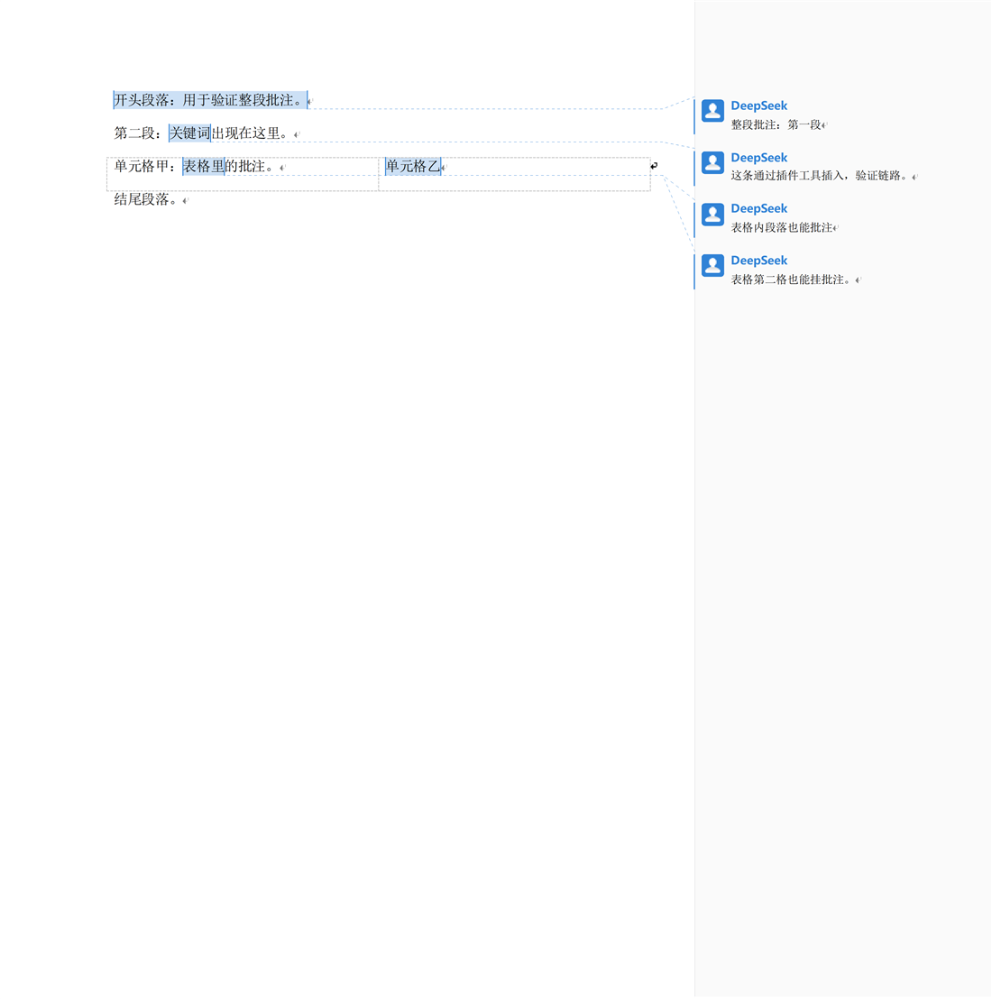

# word-comments

A companion plugin for [DeepSeek Harness](https://github.com/deepseek-ai) that adds **native
Word comments** to `.docx` files — the kind that show up in Word / WPS Writer's review pane,
with author balloons and red brackets, and stay editable there.



It is deliberately independent of the Word/Excel/PowerPoint office plugin
([`@copylee/dsh-office`](https://github.com/copylee711/dsh-office)): it edits the document
package directly (`word/comments.xml`) instead of driving a running Office instance. Two
consequences:

- **Plugin upgrades cannot remove it.** Upgrading the office plugin replaces that package
  only; this one keeps working. When upstream grows native comments, just disable this one.
- **It works even while the document is open.** No running Word/WPS is needed. If the file
  happens to be open there, the change goes to a sibling copy named `<name>-批注版.docx`
  and the open document is left untouched.

## Install

From GitHub (installs as a bundle, no build step — the plugin is plain ESM):

```
plugin_manager install_bundle -> github:<owner>/word-comments
```

From a local checkout, point the same action at the folder:

```
plugin_manager install_bundle -> D:\path\to\word-comments
```

The package is linked into the profile, so pulling updates is just `git pull` afterwards.

## Tool

One tool, `word_comments`:

| op | what it does |
| --- | --- |
| `read` | list comments (id, author, date, text, anchored paragraph and text) |
| `add` | insert comments anchored to a paragraph, optionally to a substring of it |
| `delete` | remove comments by id, or all of them |

Example `add` payload:

```json
{
  "path": "D:\\docs\\report.docx",
  "op": "add",
  "author": "DeepSeek",
  "comments": [
    { "para": 3, "expect": "第三段", "find": "关键词", "text": "这里建议补充数据来源。" }
  ]
}
```

- `para` is 1-based and counts every paragraph in the body, tables included — the same
  numbering `office_read` reports, so a paragraph number read there can be used here.
- `expect` guards against a stale paragraph number: the paragraph must start with it.
- `find` narrows the anchor to the n-th occurrence of a substring; `occurrence` chooses which.
- `copy: true` always writes to the sibling copy; `copy: false` edits in place and fails if
  the document is open. Omitted = decide automatically.

## Requirements

- Windows, `.docx` only (convert `.doc` first).
- A Python with `python-docx`. The bundled DSH runtime
  (`%DSH_HOME%\dsh-runtimes\*\dependencies\python\python.exe`) already has it and is picked
  automatically; override with the `DSH_WORD_COMMENTS_PYTHON` environment variable.

## Layout

- `index.js` — plugin entry, registers the `word_comments` tool.
- `py/comment_core.py` — the OOXML comment engine, also runnable by hand:
  `python comment_core.py read|add|delete <docx> ...`
- `cordis.patch.yml` — loader entry.
- `docs/screenshot.png` — the picture above.

## License

MIT — see [LICENSE](LICENSE).
